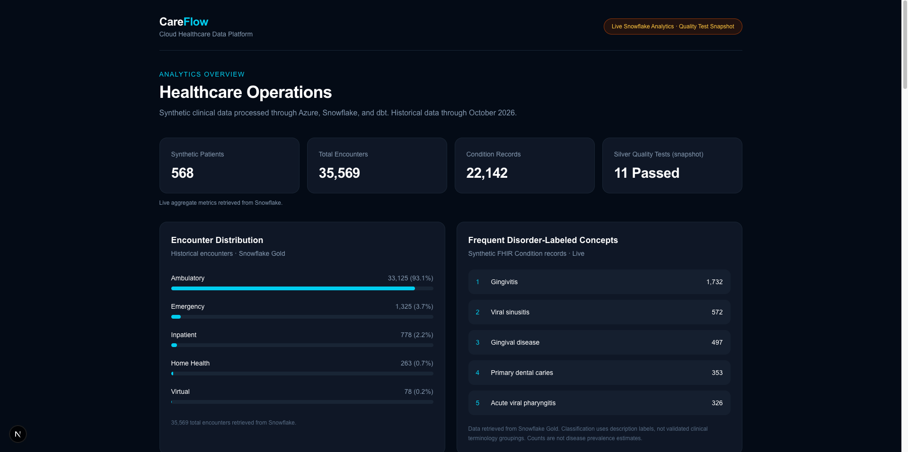
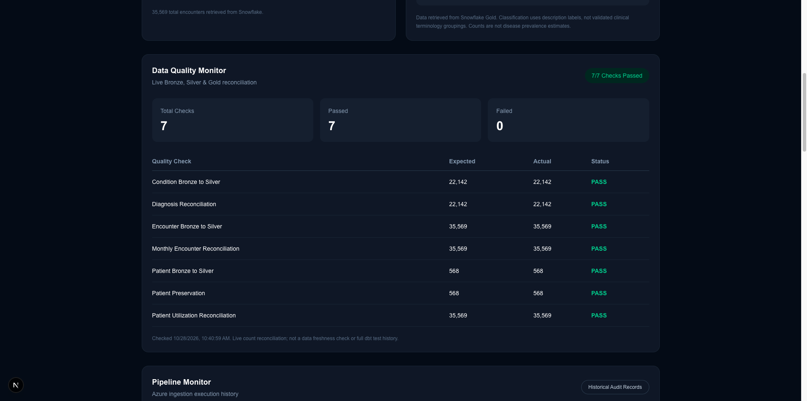
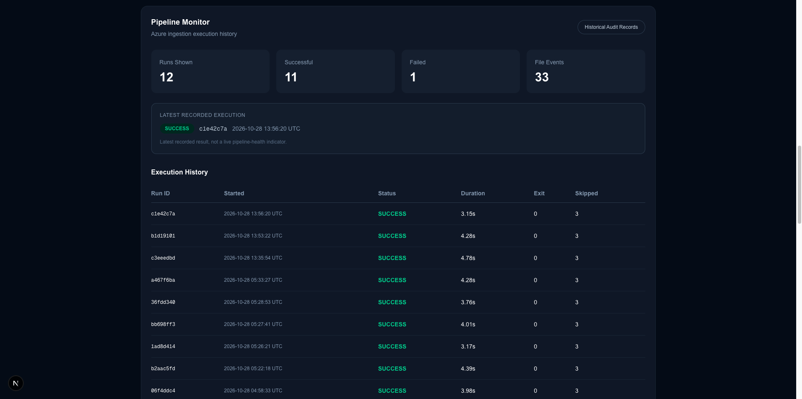
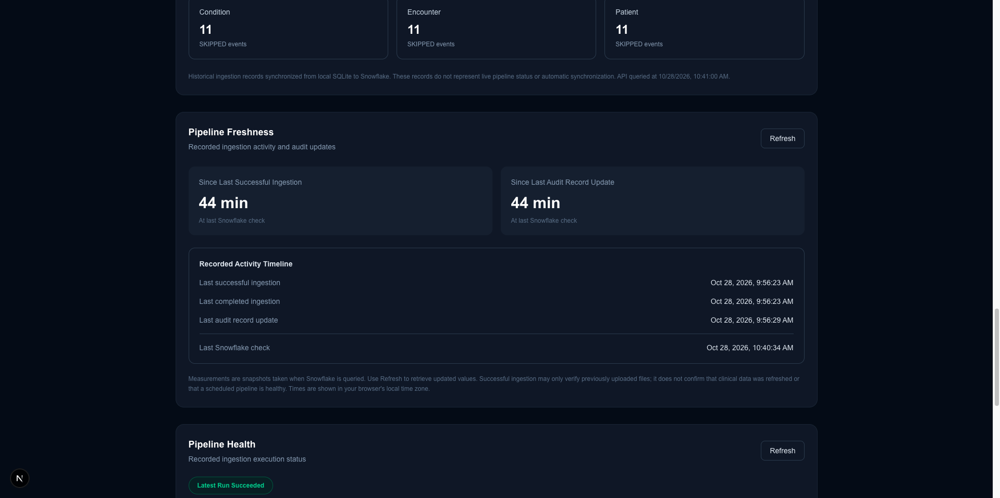
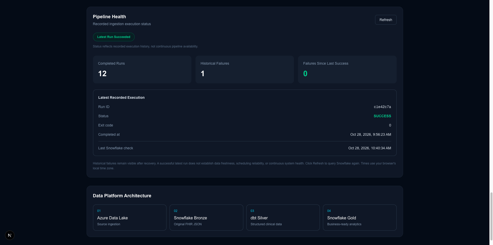

# CareFlow

### Cloud Healthcare Data Engineering & Analytics Platform

CareFlow is an end-to-end healthcare data engineering project that demonstrates cloud ingestion, data lake storage, warehouse modeling, data quality validation, operational monitoring, and interactive analytics.

The platform processes synthetic FHIR healthcare records through Azure Data Lake Storage Gen2, Snowflake, and dbt, then presents analytical insights and pipeline health through a Next.js dashboard.

## Dashboard Preview

### Healthcare Analytics

### Data Quality & Reconciliation

### Pipeline Monitoring

### Pipeline Freshness

### Pipeline Health

## Architecture

Synthea (Synthetic FHIR Data)
        |
        v
Python Ingestion Pipeline
        |
        v
Azure Data Lake Storage Gen2
        |
        v
Snowflake BRONZE
        |
        v
dbt SILVER + GOLD
        |
        v
Secure Snowflake Reporting Views
        |
        v
Next.js Analytics Dashboard

Operational monitoring runs alongside ingestion through SQLite audit records, Snowflake monitoring tables, alert detection, and email notifications.

See [Architecture Documentation](docs/architecture.md).

## Getting Started

For environment preparation, dependency installation, cloud configuration, and local testing, see the [CareFlow Setup Guide](docs/setup.md).

The repository does not yet automate provisioning of all required Azure and Snowflake resources.

## Technology Stack

| Layer | Technologies |
|---|---|
| Data generation | Synthea, FHIR, NDJSON |
| Cloud storage | Microsoft Azure Data Lake Storage Gen2 |
| Data ingestion | Python, Azure SDK |
| Data warehouse | Snowflake |
| Data transformation | dbt Core, SQL |
| Data validation | dbt tests, reconciliation checks |
| Monitoring | Python, SQLite, Snowflake |
| Notifications | SMTP, macOS Keychain |
| Orchestration | Python, macOS launchd |
| Frontend | Next.js, TypeScript, Tailwind CSS |

## Dataset

CareFlow uses entirely synthetic healthcare data generated with Synthea.

| Resource | Records |
|---|---:|
| Patient | 568 |
| Encounter | 35,569 |
| Condition | 22,142 |
| **Total** | **58,279** |

Source files are uploaded into immutable, SHA-256-addressed Azure storage paths.

No real patient records are required for this project.

## Engineering Capabilities

### Cloud Ingestion
- Processes FHIR NDJSON resources.
- Uploads content to Azure Data Lake Storage Gen2.
- Uses content-addressed paths to avoid redundant uploads.
- Records ingestion execution and file-level outcomes.

### Warehouse & Transformation
- Organizes warehouse data into BRONZE, SILVER, and GOLD layers.
- Transforms raw FHIR resources using dbt Core.
- Produces analytics-ready warehouse models.
- Validates transformations with automated tests and reconciliation checks.

### Analytics Dashboard
- Healthcare KPI summaries.
- Encounter and diagnosis analytics.
- Data quality monitoring.
- Pipeline execution history.
- Ingestion activity, freshness, and health indicators.

### Operational Monitoring
- Persistent ingestion audit history.
- Failure and recovery tracking.
- Snowflake synchronization monitoring.
- Duplicate-resistant notification queue.
- SMTP email notification dispatcher.
- Execution logs and overlap prevention.

## Repository Structure

careflow/
├── careflow-web/       # Next.js dashboard and API routes
├── careflow_dbt/       # Snowflake dbt transformations
├── scripts/            # Ingestion and operational automation
├── docs/               # Architecture and project documentation
├── tests/              # Automated tests
├── data/               # Local datasets and monitoring state (Git-ignored)
└── README.md

## Operational Status

The Azure ingestion, Snowflake audit synchronization, monitoring pipeline, and dashboard have been successfully tested.

A local macOS LaunchAgent is configured for daily execution at 9:00 AM. A manually triggered LaunchAgent execution has passed; recurring calendar-triggered execution remains to be verified.

Email notification delivery has been tested, including simulated duplicate prevention. Unattended email delivery is not yet enabled.

CareFlow is an engineering and portfolio project, not a production clinical system.

## Planned Improvements

- Comprehensive automated testing.
- Stronger alert delivery recovery and failure monitoring.
- Azure-native orchestration.
- CI/CD workflows.
- Secure public deployment.
- Improved reproducible project setup.
