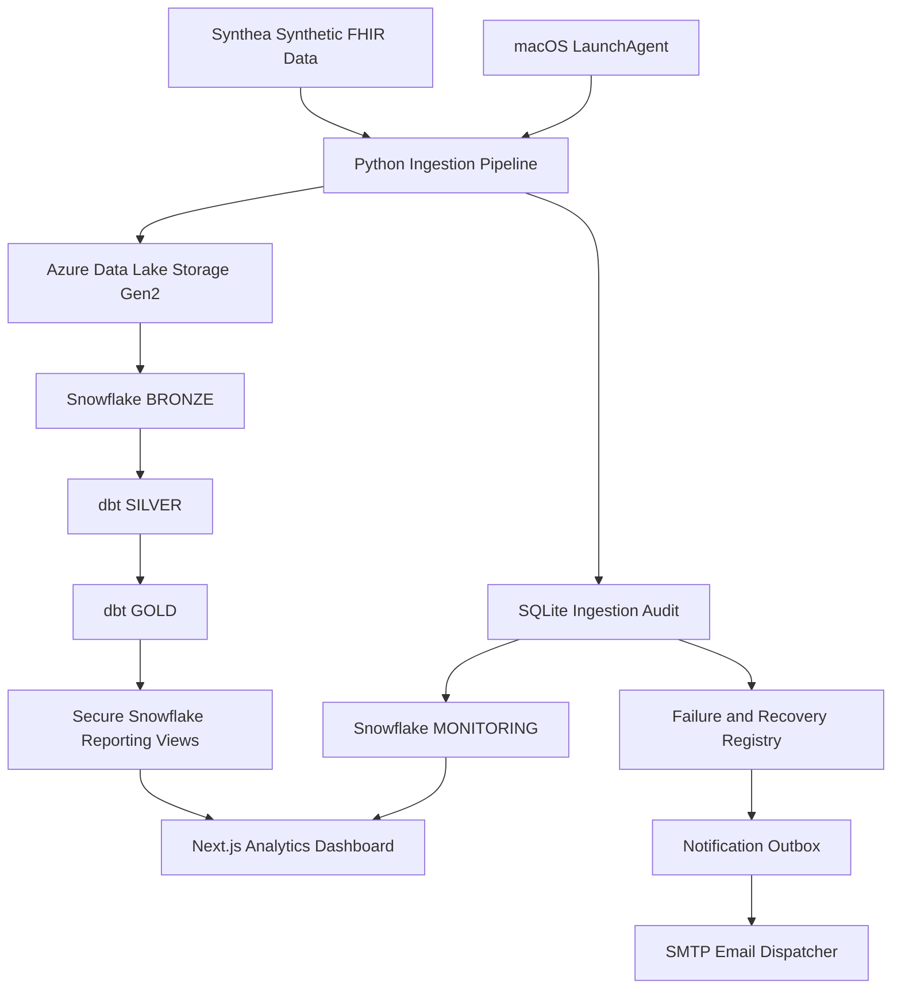

# CareFlow — Technical Architecture

## 1. Overview

CareFlow implements a layered healthcare analytics architecture using synthetic FHIR data.

The system separates raw data ingestion, warehouse transformations, analytics consumption, and operational monitoring.

## 2. Data Ingestion

**Input:** Synthea-generated FHIR NDJSON resources.

**Service:** Python Azure ingestion scripts.

**Storage:** Azure Data Lake Storage Gen2.

Resource files use SHA-256 content-addressed paths to support repeatable ingestion and prevent unnecessary re-uploads.

Primary resources:
- Patient
- Encounter
- Condition

## 3. Snowflake Data Warehouse

### BRONZE

Preserves ingested source resources using Snowflake VARIANT data.

### SILVER

Contains structured and cleaned representations of the source resources, maintained using dbt.

### GOLD

Contains analytics-ready models and reporting views.

### MONITORING

Maintains synchronized ingestion execution and file activity records used by the dashboard.

## 4. Data Quality

CareFlow uses dbt tests and reconciliation checks to validate transformations and source-to-warehouse consistency.

Validation covers record preservation and transformation integrity.

## 5. Analytics Application

The frontend uses Next.js and TypeScript.

Server-side API routes retrieve data from Snowflake through restricted, read-only reporting access.

Dashboard capabilities include:
- Healthcare analytics
- Data quality results
- Pipeline runs and file activity
- Freshness indicators
- Pipeline health

Snowflake credentials remain server-side.

## 6. Monitoring and Alerting

The ingestion pipeline records execution results in SQLite.

Monitoring components evaluate failures and recovery events, then maintain a persistent alert registry.

A notification outbox prevents duplicate queue entries and cancels pending notifications for recovered incidents.

The SMTP dispatcher uses persistent delivery claims to prevent automatic resending after uncertain delivery outcomes.

This design prioritizes avoiding duplicate delivery; an interrupted delivery may require manual review.

## 7. Local Orchestration

During development, a macOS LaunchAgent is configured to initiate the scheduled Python workflow.

The runner:
- Retrieves protected credentials from macOS Keychain.
- Builds an isolated execution environment.
- Uses file locking to prevent overlapping executions.
- Writes persistent execution logs.
- Applies an execution timeout.

This local scheduler requires an available macOS user session and is not equivalent to cloud-native orchestration.

## 8. Security Boundaries

- Synthetic healthcare records only.
- Local credentials excluded from source control.
- Snowflake private-key authentication.
- Read-only application reporting role.
- Operational databases excluded from Git.
- Email notifications omit patient-level data.

The dashboard requires appropriate application-level access controls before public deployment.

## 9. Known Operational Limitations

- Unattended execution depends on the Mac mini.
- Missed scheduled runs require independent monitoring.
- SMTP acceptance does not guarantee inbox delivery.
- An uncertain email attempt may need manual resolution.
- Monitoring freshness is not necessarily clinical source-data freshness.
- The current source dataset is static unless regenerated or updated.

## 10. Future Architecture

The intended direction is to replace local orchestration with Azure-native scheduling, secret management, centralized operational monitoring, and CI/CD.

## 11. Platform Architecture Diagram

**Operational note:** Daily scheduling is configured, but the
calendar-triggered execution remains unverified. Unattended
email delivery is not yet enabled.
